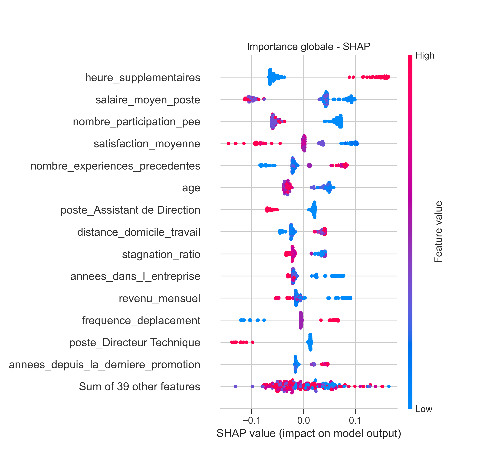

# Identifiez les causes d'attrition au sein d'une ESN

Projet de classification supervisée : **comprendre pourquoi les collaborateurs d'une ESN démissionnent** et identifier les profils à risque à partir des données RH (SIRH), des évaluations annuelles et d'un sondage interne.

> Projet 4 du parcours *AI Engineer* (OpenClassrooms).

## Objectifs

- Consolider trois sources de données RH en un jeu de données unique (1 470 collaborateurs, ~16 % de départs).
- Construire des variables métier (satisfaction, rémunération relative, stagnation, risque de burnout…).
- Entraîner et comparer plusieurs modèles de classification sur une cible **déséquilibrée**.
- Expliquer les prédictions (importance globale et locale avec **SHAP**) pour en tirer des leviers d'action RH.

## Démarche

1. **Préparation** : jointure SIRH / évaluations / sondage, contrôle qualité, analyse descriptive.
2. **Feature engineering** : 10 variables dérivées, dont :
   - variation de la note d'évaluation et chute de satisfaction ;
   - ratio salaire / salaire moyen du poste (global et par département) ;
   - croisement « non satisfait × heures supplémentaires » (risque de burnout) ;
   - mobilité interne et ratio de stagnation.
3. **Sélection de variables** : corrélations de Pearson et de Spearman, pairplots (relations non linéaires).
4. **Encodage** : binaire, ordinal et one-hot selon la nature des variables.
5. **Modélisation** : `DummyClassifier` (baseline), `LogisticRegression`, puis `XGBClassifier` optimisé (RandomizedSearch suivi d'un GridSearch local), split stratifié, scoring **F2** (le rappel des démissionnaires est prioritaire) et optimisation du seuil de décision.
6. **Interprétabilité** : feature importance, permutation importance, SHAP (beeswarm, waterfall, force plots).

## Résultats

Modèle retenu : **XGBoost**, split stratifié, pondération des classes, optimisé en F2, seuil de décision ajusté à 0,71.

| Classe « a quitté l'entreprise » (test) | Precision | Recall | F1 |
|---|---|---|---|
| Baseline (Dummy) | 0,00 | 0,00 | 0,00 |
| Régression logistique | 0,62 | 0,38 | 0,48 |
| XGBoost (split simple) | 0,39 | 0,28 | 0,33 |
| **XGBoost (stratifié + pondéré + seuil F2)** | **0,41** | **0,70** | **0,52** |

On détecte ainsi environ **7 démissionnaires sur 10**, avec un F2 de 0,61.

**Principaux facteurs d'attrition (SHAP)** : heures supplémentaires, salaire moyen du poste, faible participation au PEE, satisfaction moyenne basse, nombre d'expériences précédentes élevé, jeune âge, distance domicile-travail, stagnation de carrière.



La synthèse métier se trouve dans [reports/presentation_attrition_esn.pdf](reports/presentation_attrition_esn.pdf).

## Structure du dépôt

```
.
├── data/
│   ├── raw/                  # données sources (SIRH, évaluations, sondage)
│   └── processed/            # données intermédiaires (non versionnées)
├── models/                   # modèle XGBoost + seuil, générés par le notebook (non versionnés)
├── notebooks/
│   └── 01_analyse_attrition_modelisation.ipynb
├── reports/
│   ├── figures/              # graphiques générés par le notebook
│   └── presentation_attrition_esn.pdf
├── src/attrition_esn/
│   ├── config.py             # chemins du projet
│   └── ml_utils.py           # préparation, entraînement, évaluation, validation croisée
├── pyproject.toml
└── uv.lock
```

## Installation et exécution

Prérequis : Python ≥ 3.11 et [uv](https://docs.astral.sh/uv/).

```bash
git clone <url-du-depot>
cd <nom-du-depot>
uv sync                 # crée .venv, installe les dépendances et le package attrition_esn
uv run jupyter lab      # puis ouvrir notebooks/01_analyse_attrition_modelisation.ipynb
```

Les chemins sont résolus depuis la racine du dépôt (`src/attrition_esn/config.py`), donc le notebook fonctionne quel que soit le dossier de lancement. Les figures sont régénérées dans `reports/figures/`.

## Stack

pandas · NumPy · scikit-learn · XGBoost · SHAP · SciPy · Matplotlib · Seaborn · uv

## Auteure

Faiza Khelladi
